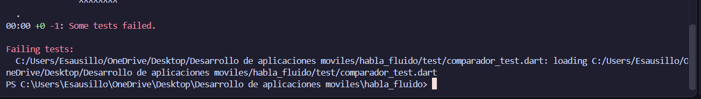
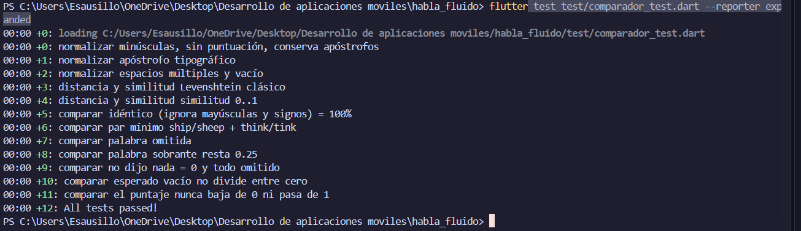
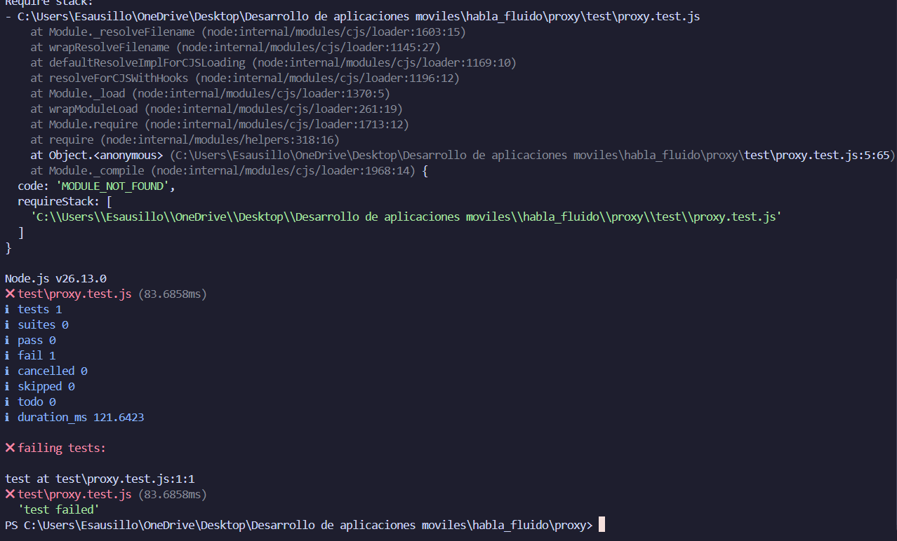
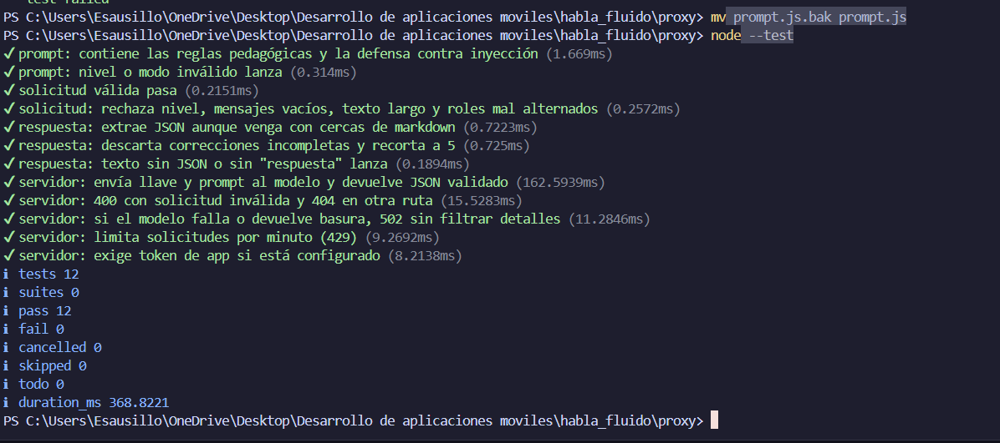
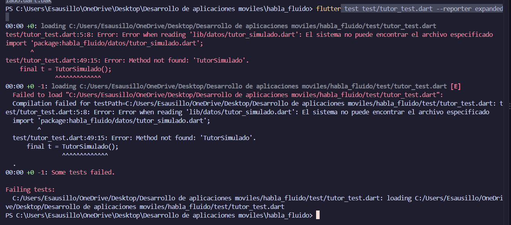
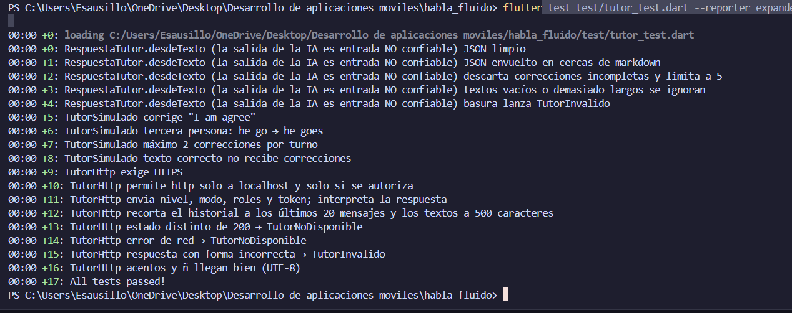
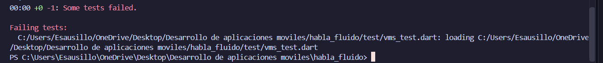
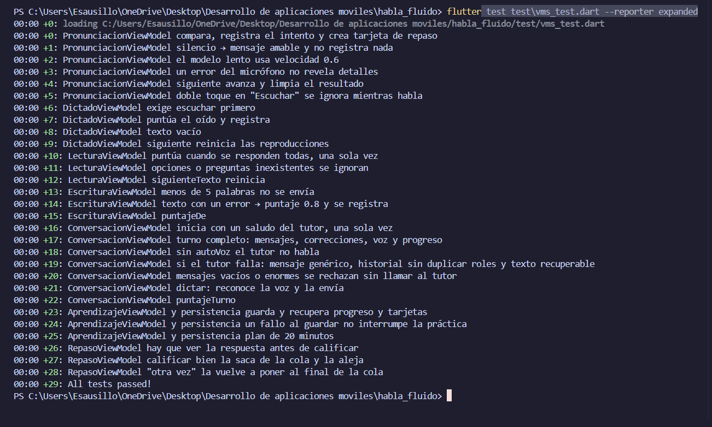

# Habla Fluido

App móvil (Flutter) para aprender inglés con un tutor de IA. Practica pronunciación, oído, lectura, escritura y conversación, con repetición espaciada (SM-2) y un plan diario que da más tiempo a la habilidad más débil.

Proyecto de la materia Desarrollo Móvil Integral, UTNG. Se desarrolló con TDD (ROJO → VERDE → REFACTOR) siguiendo el manual del Prof. Anastacio Rodríguez García.

## Estructura

```
habla_fluido/
  lib/
    dominio/          reglas puras en Dart (comparador, SM-2, progreso, plan diario)
    datos/            tutor simulado, cliente HTTP, voz, almacenamiento
    presentacion/
      vm/             ViewModels (el cerebro de cada ejercicio)
      pantallas/      interfaz
  test/               pruebas de Flutter
  proxy/              servidor Node que protege la llave de la IA
  capturas/           evidencias de las pruebas
```

## Cómo ejecutar

```
flutter pub get
flutter test                 # pruebas de Flutter
flutter run                  # con el tutor simulado (sin internet)
cd proxy && node --test      # pruebas del proxy
```

## Evidencias por ronda

En las rondas con TDD, la captura **R** (rojo) muestra la prueba fallando sin el código, y la captura **V** (verde) muestra la misma prueba pasando.

### Ronda 1. Proyecto y permisos

Proyecto creado y verificado.





### Rondas 3 y 4. Repetición espaciada, progreso y plan diario

Archivo de pruebas: `test/repaso_progreso_test.dart`

🔴 Rojo:


🟢 Verde:


### Ronda 6. Proxy del tutor

Archivo de pruebas: `proxy/test/proxy.test.js`

🔴 Rojo:



🟢 Verde:



### Ronda 7. Tutor simulado y cliente HTTP

Archivo de pruebas: `test/tutor_test.dart`

🔴 Rojo:



🟢 Verde:



### Ronda 9. ViewModels

Archivo de pruebas: `test/vms_test.dart`

🔴 Rojo:



🟢 Verde:



## Seguridad

La llave de la IA vive solo en el servidor (variable de entorno `ANTHROPIC_API_KEY` en el proxy). No aparece en ningún archivo de la app ni en Git.

## Autor

Esausillo, UTNG.